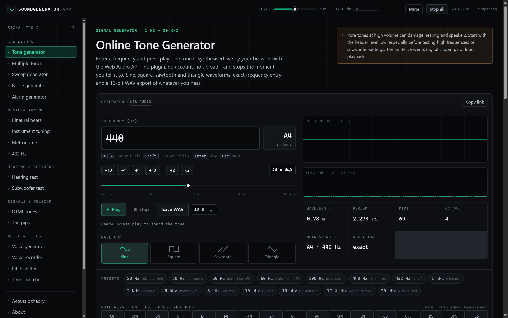

# soundgenerator.app

Precision tone, sweep and test-signal generators that run entirely in the browser.
A modern rebuild of the classic online tone generator: Astro static output, no client
framework, no server-side audio, no ads, no behavioural tracking.

**Live target:** https://soundgenerator.app



---

## What's in it

| Tool | Route | What it does |
| --- | --- | --- |
| Tone Generator | `/` | 1 Hz – 20 kHz sine/square/sawtooth/triangle, exact entry, logarithmic slider, note readout, WAV export, URL presets, note keys |
| Multiple Tone Generator | `/multiple-tone-generator` | Up to 8 independent oscillators with per-voice level and pan, shared shareable URL |
| Sweep Generator | `/sweep-generator` | Linear or exponential sweeps, start/end levels, hold and loop, live progress, WAV export |
| Noise Generator | `/noise-generator` | White, pink and brown noise with band shaping and WAV export |
| Alarm Generator | `/alarm-generator` | Beeps, double beeps, sirens, warble and pulse trains at any rate, sample-accurate |
| Binaural Beats | `/binaural-beats` | Two hard-panned carriers, delta → gamma beat bands, stereo WAV export |
| Instrument Tuning | `/instrument-tuning` | Reference pitches for 14 tunings, A4 440/432/435/415, auto cycle |
| Metronome | `/metronome` | 20–300 BPM, look-ahead scheduler, time signatures, subdivisions, tap tempo |
| 432 Hz | `/432hz` | Reference-pitch comparison and generator, with the maths and the history |
| Hearing Test | `/hearing-test` | Audiometric step-through 125 Hz – 20 kHz with saved results and CSV export |
| Subwoofer Test | `/subwoofer-test` | Low-frequency steps, room sweep, level-matched A/B |
| DTMF | `/dtmf` | Full telephone keypad, A–D, dial/busy/SIT tones, sequence dialler |
| The Pips | `/pips` | The six 1000 Hz time-signal pips with an on-the-hour countdown |
| Voice Generator | `/voice-generator` | Speech synthesis through voices installed on the device |
| Voice Recorder | `/voice-recorder` | Microphone recording with live waveform and true WAV download |
| Pitch Shifter | `/pitch-shifter` | Shift any audio file by semitones, with or without tempo correction |
| Time Stretcher | `/time-stretcher` | Change tempo without changing pitch (WSOLA), loop and export |
| Acoustic Theory | `/theory` | The maths: waves, harmonics, decibels, sampling, cents, room modes, safety |
| About / Privacy / 404 | `/about` `/privacy` `/404` | How it works and what it stores (nothing) |

## Stack

- **Built with** Astro 7 (static output, `format: 'directory'`), `@astrojs/sitemap`
- **Tailwind CSS v4** through `@tailwindcss/vite` - design tokens live in `src/styles/global.css`
- **TypeScript**, strict
- **Web Audio API** for every signal; **OfflineAudioContext** for every download
- Zero runtime dependencies. The only third-party request is Google Analytics (page views, production builds only,
  skipped when the browser sends Do Not Track or Global Privacy Control). No CDN, no web fonts, no ad code.

## Commands

```bash
npm install
npm run dev        # http://localhost:4321
npm run build      # static output in dist/
npm run preview    # serve dist/ locally

npm run verify     # static checks on dist/ (routes, no external assets, SEO basics)
npm run seo        # SEO, metadata and structured-data audit of dist/
npm run og         # render public/og.png (1200x630 social preview) from /og-card
npm run qa         # headless browser sweep of every page (screenshots + audio assertions)
npm run audio-test # numeric DSP checks (frequency, harmonics, noise tilt, WAV bytes)
```

`npm run build` runs `astro build` and then `tools/inject_schema.mjs`, which generates
FAQPage structured data from the FAQ markup that is actually rendered on each page, so the
structured data can never drift from the visible copy.

`qa` and `audio-test` drive a headless Edge/Chrome over the DevTools Protocol
(`tools/lib/cdp.mjs`, no Puppeteer). They expect a running server:

```bash
npm run dev                       # terminal 1
npm run audio-test                # terminal 2
npm run qa                        # terminal 2
npm run qa -- --mobile            # 390 px pass (layout and tap targets)
```

Set `SG_BROWSER` to a browser executable if the automatic lookup misses yours.

## SEO and metadata

Everything is generated from `src/data/tools.ts` so a page cannot ship without it:

- **Titles**: `<tool title> | <site name>`, 31 to 52 characters. The home page uses
  `Online Tone Generator | Free Online Signal Generator`.
- **Descriptions**: a dedicated `meta` field per tool, 134 to 152 characters, unique across
  the site and written to stand alone in a result list. `tagline` (short UI copy) and `meta`
  (search copy) are deliberately separate fields.
- **Canonical**: one per page, always absolute on `https://soundgenerator.app`.
- **Robots**: `index, follow, max-image-preview:large, max-snippet:-1` on indexable pages,
  `noindex, nofollow` on `/dev/*`, `/og-card` and `/404`.
- **Open Graph / Twitter**: type, site name, locale, title, description, url, image plus
  `og:image:width/height/alt`. The image is a real 1200x630 PNG rendered from
  `/og-card` by `npm run og`, so the reference never 404s.
- **Structured data**: `WebApplication` on every tool page; `BreadcrumbList` on every page;
  `FAQPage` on the 16 pages with an FAQ (64 questions) generated post-build from the rendered
  markup; `WebSite` plus `Organization` on the home page. Validated by the audit, including
  the shape of each `Question`/`Answer`.
- **Sitemap and robots.txt**: `@astrojs/sitemap` with `lastmod`, `/dev/*` and `/og-card`
  excluded; `robots.txt` points at the sitemap.
- **Footer credit**: `Developed by Tehnika.mk - Digital Agency`, linked to
  `https://tehnika.mk` from `SITE.credit`.
- **Analytics**: Google Analytics 4 (`G-FK8YJ3XSX7`, in `SITE.gaId`) via
  `src/components/Analytics.astro`. Production builds only (`import.meta.env.PROD`), skipped
  on `noindex` pages, and the loader is injected at runtime so a Do Not Track or Global Privacy
  Control signal stops it before any request is made. Set `SITE.gaId` to an empty string to
  disable it entirely, or change `respectSignals` to `false` to ignore those signals.

House style: no em dashes anywhere in the source or the output (`npm run seo` fails if one
reappears, in any file). Ranges use en dashes, and the sentence-level separator is a spaced
hyphen.

Run `npm run build && npm run seo` to check the numbers above on your own machine.

## Architecture

```
src/
  data/tools.ts          tool registry: navigation, titles, descriptions, keywords
  layouts/Base.astro     head/SEO/JSON-LD shell, header transport, nav rail, footer
  components/            Panel, SiteHeader, SiteRail, SiteFooter, WaveIcon
  lib/audio/
    engine.ts            shared AudioContext, master gain, limiter, analyser, voice tracking
    voices.ts            ToneVoice, NoiseVoice, SweepVoice, click and dual-tone helpers
    wav.ts               offline rendering + 16-bit PCM WAV encoding + downloads
    notes.ts             note maths, presets, tuning tables, DTMF/pips/alarm/binaural data
    scope.ts             oscilloscope and spectrum canvas renderers
    analysis.ts          Goertzel, RMS, peak, zero-crossing frequency estimation
    debug.ts             window.__sg diagnostics used by the automated checks
  lib/ui/
    tone-generator.ts    the reusable "frequency + transport + export" panel controller
    transport.ts         global volume / mute / level meter / stop-all
    dom.ts               DOM and sharing helpers
  pages/                 one page per tool, plus /dev/audio-checks and /og-card (noindex)
  scripts/               page wiring, one module per page
tools/                   verify_dist.mjs, seo_audit.mjs, inject_schema.mjs, make_og.mjs,
                         browser_qa.mjs, audio_tests.mjs, lib/cdp.mjs
docs/                    BUILD-CONTRACT.md (how pages are built), DEPLOY.md
```

Signal path: `voice → master gain → limiter → analyser → output`. The limiter is a safety
net against digital clipping, not a loudness control; the header slider is the master level
(50 % = −12 dB, 100 % = 0 dB) and it persists in `localStorage`.

## Accuracy notes

- Frequencies are exact to the oscillator: the value you type is the value generated. The
  readout also shows the nearest equal-tempered note and the deviation in cents.
- The tone is sampled at your device's rate (usually 44.1 or 48 kHz, shown in the header).
  Anything above `sampleRate / 2` cannot be represented; the UI caps input at 20 kHz.
- WAV exports are rendered offline by the same code path as the live preview, so what you
  save is what you heard.
- The hearing test is not a medical device and cannot diagnose hearing loss.

## What was verified, and how

Not "it builds" - measured output. Run `npm run audio-test` and `npm run qa` yourself.

**DSP checks - 23/23 pass** (`qa-artifacts/audio-tests.json`):

| Check | Measured |
| --- | --- |
| 440 Hz sine frequency | 440.00 Hz (zero-crossing count) |
| 440 Hz sine amplitude at gain 0.5 | peak 0.5000, first sample 0, 10 ms fades |
| Square wave harmonics | 2nd −124.7 dB (absent), 3rd −15.9 dB (odd-only confirmed) |
| Sawtooth / triangle harmonics | 2nd −6.0 dB present / −125.6 dB suppressed |
| White noise spectrum | −1.3 dB tilt between 100–400 Hz and 3–8 kHz |
| Pink noise slope | 14.8 dB over the span (≈ −3.2 dB/octave) |
| Brown noise slope | 27.9 dB (≈ −6 dB/octave), ≥ 6 dB steeper than pink |
| Exponential sweep 20 Hz → 20 kHz | 40 Hz at 10 %, 10 220 Hz at 90 % (theory: 40 / 10 024) |
| Linear sweep 100 → 1100 Hz | 600 Hz at the midpoint |
| Pitch shift +12 semitones | 880.0 Hz, duration unchanged at 2.00 s |
| Pitch shift −12 semitones | 219.4 Hz, duration unchanged at 2.00 s |
| Time stretch 0.5× / 2× | 440.0 Hz at 4.00 s / 438.8 Hz at 1.00 s |
| WAV export | RIFF/WAVE, 1 ch, 44 100 Hz, 16-bit, int16 peak 16 383 |
| Music maths | A4 = 440, A3 = 220, 880 Hz = A5, 432 Hz = −32 cents |
| Master taper | position 50 → 0.25 (−6.02 dB at 0.5) |

**Live output - 21/21 routes clean** on desktop and at 390 px, against both the dev server and
the production build (`qa-artifacts/report.json`, `report-mobile.json`). Every sound-producing
page was activated with a trusted input event and its output measured through the shared
analyser: tone generator 0.153 RMS, tuning string 0.153, DTMF key 0.107, multiple tones 0.097,
subwoofer step 0.084, alarm 0.075, sweep 0.067, noise 0.039, pips 0.038, binaural 0.030,
metronome 0.019, hearing test 0.005. The sweep also asserts that the header "Stop all" returns
every page to silence, checks for horizontal overflow, missing accessible names and console
errors, and verifies all internal links resolve. Microphone, speech and file-processing pages
are marked as needing a manual check (they cannot run headless).

## Deployment

Static output - any host works. See `docs/DEPLOY.md` for Netlify, Vercel and Cloudflare
Pages settings plus the DNS records for `soundgenerator.app`.
